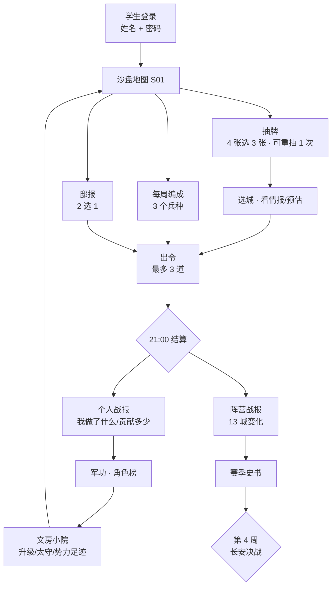

# 当前游戏全流程（2026-11-11）

> 本文以**已经实装的代码**为准，不再沿用早期 12 节点/资源/角色版本的设定。
> 目标：让学生 15–20 分钟完成一天，教师每天不超过 5 分钟。

---

## 0. 一页总览



---

## 1. 角色与时间

| 角色 | 做什么 | 频率 |
|---|---|---|
| **学生** | 看地图、抽牌、编成、出令、看战报、升小院 | 每天 15–20 分钟 |
| **教师** | 开局、锁定、结算、下一回合、看班级战局 | 每天 < 5 分钟 |
| **系统** | 21:00 锁定/结算、写战报/军功/太守 | 自动 |

时间预算：

```text
晨报/地图      2 分钟
抽牌 + 编成    2 分钟
军议 + 预估    3 分钟
出令           3–5 分钟
看战报         2 分钟
小院/军功      2–3 分钟
可选：回放/史书 5 分钟
```

---

## 2. 首次进入

```text
1. 学生打开 App，填姓名 + 密码
2. 自动进入正在进行的游戏（教师开局时已分好阵营）
3. 首次 3 步教学：
   ① 点城 → 看出令
   ② 点手牌 → 选目标
   ③ 确认 → 21:00 结算
4. 落到沙盘地图 S01
```

当前**没有**：

```text
选阵营（教师开局脚本分配）
选角色（将军/军师/粮官/斥候，旧设计，已不在当前闭环）
选班宠（直接读 student_pets）
```

---

## 3. 每天的核心循环

### 3.1 打开 App：先看“今天发生了什么”

设计目标：

```text
昨日战报折页
四榜（先锋/支援/侦察/守城）
班宠一句话
邸报传闻
今日地图变化
```

当前实现：

```text
S04 战争日报可看上一回合
S01 地图直接打开
还没有“每天第一次登录自动弹晨报”
```

**待定：晨报是自动弹，还是顶部红点提示？**

### 3.2 抽牌

```text
每天 4 张手牌，最多出 3 张
可重抽 1 次
手牌由服务端种子固定，刷新不变
书房等级提供“预读”牌，不进入手牌
```

### 3.3 每周编成

```text
每周第一次进入 S03 编成
3 个兵种，可重复
混编：3 种不同 → 攻防 +5%
专精：3 种相同 → 攻击 +8%、防御 -8%
2+1：无加成
练兵场等级决定本周可改编成次数
```

### 3.4 邸报

```text
每天从 3 个备选里抽 2 个：
粮草：你的队伍兵力 +5%
器械：你的队伍攻城伤害 +25%
斥候：本回合所有敌城守军可见
结算前可改
```

### 3.5 选城与军议

```text
只能从己方领土打相邻城
打自己城 = 驻守
未侦察敌城只显示归属/民心，不显示守军
已侦察/中立城显示守军编成
战前预估：破墙、战果、民心、克制、建议
```

### 3.6 出令

```text
每道令 = 1 张牌 + 1 座城 + 1 条路 + 前/后排
队伍牌：同阵营同城战力前 3 名成为先锋
支援：其余同阵营出令玩家每人 +2%，上限 +15%
火攻/侦察/疑兵不占队伍位
```

### 3.7 等待与结算

```text
20:30 地图变暗、倒计时
21:00 服务端锁定 + 结算
每座城只打一场
攻方 = 该城令数最多的阵营；平局对峙
先破墙，再推民心；民心满则易主
长安 5 格，关隘/大营/文城 3 格，普通 2 格
```

### 3.8 战后：先看“我”，再看“天下”

```text
第一屏：我的战报
  我今天下了几令
  每条令的角色（先锋/支援/侦察/火攻/驻守）
  伤害/破墙/损失/贡献%
  军功 + 本周排名 + 高光句
  文房小院 +X 军功 [去看看]

第二屏：阵营战报
  13 城变化
  关键战役
  四榜

第三屏：回放
  3 路 × 前后排
  克制触发
  战术触发
  破墙/民心/易主
```

### 3.9 小院与军功

```text
军功来自：出令/先锋/支援/侦察/火攻/破城/守城/驻守
书房：预读牌
练兵场：额外改编成
望楼：侦察多看邻城
每城每周贡献第一 = 太守，地图挂小旗
势力足迹：最近 7 天参与过的城
```

---

## 4. 每周循环

```text
周一：新编成、新邸报池、上周太守结算
周二–周日：每天 3 令
周日 21:00：本周最后一回合
下周一：新一周、编成可换、太守刷新
```

---

## 5. 赛季循环

```text
第 1 周：扩张，抢中立城
第 2 周：阵营碰撞，争区域 +5%
第 3 周：长安开放
第 4 周：只能打长安和长安邻城
第 28 回合：城数 > 民心定胜负；占长安直接赢
```

胜负：

```text
占长安：直接获胜
否则：城数最多；同城数比民心
```

---

## 6. 服务端结算流程

```text
1. cron 找到 deadline 已过的 running 游戏回合
2. 锁定回合（生成快照）
3. 判断规则：cards_v1 / 13 城 / 有 slice_order_slots → 卡牌结算
4. 按城聚合令
5. 算先锋/支援/编成/大营/区域/关隘
6. BattleEngine 60 tick 自动战斗
7. 推民心、写 slice_battles / slice_node_changes
8. 写 slice_turn_results（战报）
9. 写军功 slice_merit_events
10. 周日结算后刷新太守
11. 回合状态 settled
```

---

## 7. 界面地图

| 页面 | 键 | 入口 | 状态 |
|---|---|---|---|
| 沙盘地图 | S01_MAP | 登录后 | 已实装 13 城 + 迷雾 + 预估待接 |
| 文房小院 | S02_CITY_HUB | 底部导航 | 已实装 |
| 军团编组 | S03_ARMY | 底部导航 | 已实装 |
| 战争日报 | S04_REPORT | 底部导航/结算 | 已实装个人战报 |
| 战局复盘 | S05_REPLAY | 底部导航 | 已实装 |
| 班宠将军 | S07_GENERAL | 左栏 | 占位 |
| 文脉图鉴 | S08_CODEX | 左栏 | 占位 |
| 文房榷场 | S09_SHOP | 左栏 | 占位 |
| 四候赛季 | S10_SEASON | 左栏 | 占位 |
| 设置 | S11_SETTINGS | 右栏 | 已实装 |
| 军府谕告 | S12_MAIL | 右栏 | 占位 |

---

## 8. 接口映射

| 流程 | 接口 |
|---|---|
| 登录 | `POST /api/auth/login` |
| 状态/地图/手牌/军功/小院 | `GET /api/slice/state` |
| 抽牌/重抽 | `GET /api/slice/hand`、`POST /api/slice/hand/redraw` |
| 编成 | `GET/POST /api/slice/composition` |
| 邸报 | `GET/POST /api/slice/bulletin` |
| 出令/撤令 | `POST /api/slice/order/play`、`POST /api/slice/order/withdraw` |
| 战前预估 | `POST /api/slice/battle/forecast` |
| 个人战报 | `GET /api/slice/me/report` |
| 战报/回放 | `GET /api/slice/report`、`GET /api/slice/battle`、`GET /api/slice/replay` |
| 军功 | `GET /api/slice/merit` |
| 小院 | `GET /api/slice/estate`、`POST /api/slice/estate/upgrade` |
| 赛季 | `GET /api/slice/season`、`GET /api/slice/season/history` |
| 教师 | `/api/slice/admin/*` |

---

## 9. 当前实现状态

```text
已实装：
- 13 城 / 4 阵营 / 19 边 / 28 回合
- 4 抽 3、编成、邸报、出令、撤令
- 3×2 自动战斗、克制、战术、器械、民心
- 个人战报、军功、角色榜
- 文房小院、太守、势力足迹
- 战前预估（后端）
- 教师控制台、赛季史书
- 5 套客户端测试 + 18 项后端测试

未实装：
- 每日晨报自动弹出
- 选阵营/选角色
- 赛季结束动画/颁奖页
- 真实学生试跑
- GPT 小院插画（当前占位图形）
```

---

## 10. 待拍板的流程冲突

| # | 冲突 | 影响 | 建议 |
|---|---|---|---|
| 1 | 文案写“每日 1 道军令”，手牌区写“3 队将令已满” | 学生不知道能出几令 | 统一为“每天最多 3 令” |
| 2 | 区域 +5% 与 ADR-022“不做区域控制奖励”冲突 | 规则与决策文档不一致 | 要么改 ADR，要么删区域加成 |
| 3 | 文房小院 vs 原“不做基地建造” | 范围与验收标准不一致 | 明确小院是“个人反馈层”，不是基地 |
| 4 | 纸阵营色 `#CF8325` vs `#C9A227` | UI 不一致 | 以设计系统为准统一 |
| 5 | 晨报未实现 | 每天第一个爽点缺失 | 先做顶部红点 + 可展开晨报 |
| 6 | 阵营/角色选择未实现 | 旧文档与现实不符 | 明确由教师分配，删旧流程 |
| 7 | 21:00 自动结算已修，但下一回合仍要教师点 | 教师每天要点一次 | 可加 07:00 自动开新回合 |
| 8 | 试跑回合 600 秒，正式版应 24 小时 | 试跑与正式节奏不同 | 配置区分 trial/prod |

---

## 11. 请反重力/GPT 重点看

### 反重力

```text
1. 这份流程和你做的 S01–S05 是否对得上？哪里是死路？
2. 每天第一次登录，晨报应该自动弹还是红点？
3. 小院放在“看完战报之后”是否顺？
4. S01 城池抽屉里，预估卡放在出令按钮上方是否合适？
5. 13 城 + 小院 + 个人战报后，底部 5 个 tab 还够吗？
6. 赛季结束/长安易主，需要哪个页面承接？
```

### GPT

```text
1. 一个 10 岁学生看这份流程，会在哪一步迷路？
2. 第一天 5 分钟，最需要哪张插画/引导？
3. 晨报、赛季结束、太守当选，各需要什么视觉？
4. 小院 7 张资产之外，还缺什么？
5. 整体流程有没有“看起来像热门游戏”的缺口？
```
