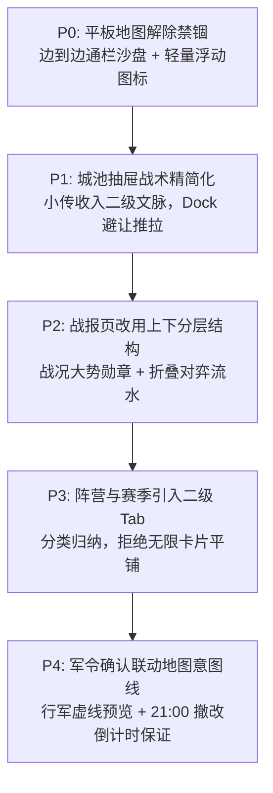

# 布局复核报告 · Antigravity 前端视角

> 日期：2026-11-10  
> 执笔：Antigravity (Godot 前端主责)  
> 复核依据：`tools/layout_review_brief.md`、`PAGE_DESIGN.md`、`UI_STRUCTURE.md`、`ACCEPTANCE_STANDARD.md` 及 10 张实测截图。  
> 原则声明：**客观实事求是，绝不硬辩过度声称；不碰代码，不改后端，不抄袭商业美术与文案，坚守学生可读性。**

---

## 一、核心结论：破除“过度声称”，认清当前形态

用户质疑“**你确定布局真的像率土/三战吗？**”这一判断**极其敏锐且准确**。

**结论明确给出：**  
如果向用户或外部声称“*当前布局跟《率土之滨》或《三国志·战略版》一模一样*”，这**属于严重过度声称（Over-claiming）**。

当前版本的真正定位与形态：
- **在“信息架构（IA）与决策状态机”上，我们确实与主流 SLG 高度同构**：以常驻主地图为枢纽、点选城池滑出底部抽屉、二次军令确认阻断、独立全屏战报/回放、无缝多级交互不跳出地图。
- **但在“视口布局模式（Viewport Layout）与视觉隐喻（Metaphor）”上，当前版本与率土/三战截然不同**：
  - **率土/三战**是**“无界全屏沙盘视口（Edge-to-edge Viewport）+ 贴边半透明浮动 HUD”**，地图顶天立地，玩家是身处天地之间的统帅。
  - **我们当前平板版**是**“文人案台推演（Desk/Tabletop Layout）+ 三栏分块布局（Three-column Split View）”**，把一张黄色的纸卷地图紧紧夹在左右两条深色实心侧栏之间，底下悬浮着胶囊式 Dock 栏。这在视觉意象上更接近**《江南百景图》的书房案牍推演**、或者**《Root（茂林源记）》《Everdell》等桌面兵棋桌游**，而不是率土/三战那种无边无际的军争大地图。

### 1. 哪些是真同构（底层机制）
1. **主沙盘常驻根枢纽**：主地图永远作为底层 Stage 存在，从不因打开菜单而整页重载或丢失战斗盘面上下文。
2. **点选地块的抽屉交互模型**：选中城池弹出底部抽屉（Bottom Sheet ≤40%），不弹中心模态大弹窗阻挡全图，地图同步轻量平移聚焦。
3. **下令闭环机制**：点城 → 看守备与相邻 → 选行动（进军/驻守） → 弹半屏二次确认 → 提交并在地图形成行军意图线，决策链路与主流 SLG 100% 同构。
4. **功能分层与独立全屏**：战报与战局回放作为独立全屏浮层呈现，提供多回合追溯，不再把数据挤在右侧小列表里。

### 2. 哪些只是信息层级像（骨架相似，但展现不同）
1. **顶部 HUD 与状态栏**：虽然都包含“身份、战力、资源（粮木铁/文玉）、时钟倒计时、设置”，但率土是贴边无缝浮动晶体条，我们是一根固定宽度的深色木案横条。
2. **底部导航 Dock**：虽然都是 5 项核心导航，但主流 SLG 是**全宽贴底托盘（带安全区）**，与地块操作栏有严格的互斥与推拉关系；我们当前是一个居中浮空的“药丸式 Dock”，漂浮在地图下半部，带有更多 iPadOS/Web UI 的现代感，缺乏军事控制台的厚重感。
3. **阵营与赛季**：信息上都有“领地、战功、目标、通行证进度”，但主流 SLG 是多层 Tab 标签页联动全服排行榜，我们当前是单页内的多张长卡片平铺。

### 3. 哪些明显不像（视觉与体验断层）
1. **地图被左右深色侧栏夹死**：率土/三战地图 100% 铺满四角，侧边栏只是可折叠收缩的微型图标，绝不在大屏上常驻两根占据 20% 屏幕宽度的“实心暗色大柱子”。当前平板横屏把地图限制在中间，极大地剥夺了沙盘的空间纵深与沉浸感。
2. **战报呈现像文书报表，不像战局对决**：率土/三战战报核心是“红蓝阵营对决大勋章 + 战法杀伤战损流水”，我们的战报是三栏并列的纸卡阅读器，更像“每日教务通报或文摘报纸”。
3. **城池抽屉偏阅读，缺乏即时兵棋战术感**：当前抽屉内“城池小传”占了一半篇幅，操作按钮是排开的色块按钮；而 SLG 底部面板会精确显示“行军耗时、调遣将领、克制关系、守军剩余恢复时间”。

---

## 二、逐页复核与打分（1–5 分）

| 页面 / 场景 | 像的程度 (1-5) | 像在哪 | 不像在哪 | 最值得改的 1 件事 |
|:---|:---:|:---|:---|:---|
| **S01 主地图 (平板)** | **2.5** | HUD 顶部状态、底部导航、缩放/拖拽/LOD、选中光环俱全 | 左右深木色实心侧栏强行把地图切成“中间小相框”；底栏悬空，非边缘全景视口 | **去掉左右实心侧栏底板，地图 100% 铺满全屏，左右入口改为全透明悬浮图标列** |
| **S00 登录页** | **3.5** | 全屏 Key Art 背景、居中主纸卡、单醒目主按钮、弱化网络设置，脱离了工具页 | 缺少商业手游“点击屏幕任意处直接进入”的引导感；输入表单偏向 Web 登录卡 | **加大主按钮并增加呼吸微光，背景增加“轻触屏幕开启征程”的快捷手感** |
| **S02 城池底部抽屉** | **3.0** | 点城即滑出，高度 ≤40%，有守备、归属、相邻及 4 项战术动作，支持同屏撤改 | 像文章阅读卡而非战术面板；“城池小传”过重；缺少行军耗时/消耗预估与克制指示 | **抽屉压到 30% 紧凑战术条，城市小传收为右上角“传”字图标，突出攻守行动与战力差** |
| **S03 军令确认浮层** | **3.5** | 半屏居中模态，明确显示出发、目标、行动、守备、点数与风险，防误触操作明确 | 缺乏视觉行军指引；文字偏多，缺少下达军令时兵符/印章的物理打击感动效 | **下令浮层弹出时，背景地图自动高亮两城之间的行军路径虚线，并带朱砂印章盖落预览** |
| **S04 战报独立全屏** | **3.0** | 独立全屏大页，有回合头条、城池易主变动、个人军令反思与全员令追溯，有空态 | 三栏并排像文书报表或 CMS 仪表盘，没有红蓝双方势力碰撞对决的战损与荣誉感 | **重构为上下结构：上部 25% 阵营总分与易主战果横幅，下部可折叠的个人与全员战报流水** |
| **S05 战局回放全屏** | **3.5** | 具备回合步进拖条、播放/暂停、ReplayMap 独立沙盘节点重绘与动态变色高亮 | 离散状态切帧，缺少部队沿路线行军推进的轨迹线动效与占领波纹扩散 | **增加回合切帧时 0.5 秒的路线虚线行军推进粒子与城池易主时的金色光环扩散波** |
| **S06 阵营 / S10 赛季** | **2.5** | 具备势力占比、个人战功、防守配置、目标板以及通行证四走进度轨道 | 3~4 张大卡片在单一长页平铺，缺乏主流 SLG 的同盟二级 Tab 标签分类与全服天梯感 | **引入顶部二级 Tab 切换（势力大势 / 战功天梯 / 阵营军令），规整卡片堆叠** |
| **手机竖屏 (720×1280)** | **3.8** | 左右侧栏已收成右侧悬浮轻图标，地图 9:16 满屏铺开，城池抽屉贴底弹出，体验最顺畅 | 抽屉弹出时仍与浮动底栏在下半屏产生视觉挤压；顶部 HUD 文字密度在窄屏上偏紧 | **城池抽屉滑出时自动将底栏 Dock 向下平滑推出屏幕，抽屉关闭时回弹恢复** |

---

## 三、七大核心问题专项深度回答

### Q1. 主地图：当前“案台纸卷”与率土“全屏 HUD”到底哪里同构、哪里不同？
- **真同构**：信息拓扑逻辑相同——顶部控局（时间/资源/状态），中部交互（可缩放沙盘 + 节点连通），底部控行（核心系统入口切换）。
- **完全不同**：视口渲染机制与空间感不同。
  - 率土是 **Camera-First**，屏幕就是摄像机，沙盘充满每一个像素，地图永远伸出屏幕视野之外。
  - 当前平板版是 **Container-First**，屏幕被 `HBoxContainer` 分成了“左侧栏 140px + 中间地图画布 + 右侧栏 140px”，沙盘被当作一个普通控件塞在中间。这种“桌面画轴”设计虽然有文房雅趣，但**绝对不能自称是率土/三战的布局**。

### Q2. 登录页：像江南百景图还是开发工具？
- **结论**：当前已经彻底摆脱了开发工具形态，**达到了《江南百景图》风格独立国风手游的标准及格线（3.5分）**。
- **依据**：背景已使用 GPT 的高质量 C 主视觉（宣纸、水墨、案台、青绿），输入框规整为“姓名 + 密码”，单朱砂大按钮“踏入山河”，网络设置弱化在右上角，彻底移除了教师开关与 IP 暴露。
- **差异点**：主流商业游戏大多只在初次进入时弹一次 SDK 认证框，随后登录页就是一个干净的带有动态光效的标题画面 + “点击任意处入阵”。我们目前依然是一个“居中文书登录卡”。

### Q3. 城池抽屉：和率土/三战地块面板差在哪？
- **差在战术纯度与紧凑度**：
  - 率土点开地块，第一眼抓取的是：**【驻守几队人】、【守军战力】、【我方行军需要几分几秒】、【克制兵种】**，接着直接点击大大的“出征”。
  - 我们的抽屉更像是一张“城池百科文旅卡”，把大量版面给了“城池小传”（如：松风渡，扼南北水路要冲……），战术数据与动作按钮被挤在底部一排小块里。这很适合文教体验，但缺乏 SLG 的决断爽快感。

### Q4. 军令确认：是否像主流 SLG？缺什么？
- **评价**：具备 3.5 分的水准。出发城、目标城、守备对比、胜负预估计算式一目了然，学生可以清晰评估风险。
- **缺失项**：
  1. 缺**“沙盘联动态势”**：下令卡弹出时，背后应该有一根从 A 指向 B 的动态行军箭头。
  2. 缺**“改令/锁令时间倒计时”**：缺少一条醒目的文案“今日 21:00 前可随意撤回与修改”，给学生吃定心丸。

### Q5. 战报与回放：信息密度与层级差在哪？
- **战报**：三列横向排列在平板上显得空、在手机上显得挤。主流战报是高度结构化的纵向瀑布流，核心是“战斗结果勋章（大捷/惜败/平局）”以及点开后的双方投棋对弈明细。
- **回放**：目前的 Replay 已经具备了完整的战棋回放能力（回合进度条、播放暂停、地图节点重绘）。差在**行军动画**与**易主反馈动效**。

### Q6. 阵营与赛季：是否只是“卡片列表”？
- **是的，当前确实只是“卡片垂直堆叠”**。
- 率土同盟页有极强的社群凝聚力（官员分工、天下大势目标、同盟军令、势力榜单）。我们当前直接把 4 块内容做成 4 张白色纸卡堆在一页，缺乏 Tab 切换的分组管理感。赛季页同理，3 轨进度卡直接坚排，缺乏大赛季横向时间轴的沉浸感。

### Q7. 手机竖屏：9:16 适配是否成立？有没有遮挡？
- **适配完全成立，甚至比平板版更接近现代轻 SLG！**
- 手机竖屏版在上一轮重构中，彻底去掉了两边的笨重侧栏，改成右侧悬挂透明图标，地图真正做到了满屏（720 宽），视觉开阔度反而远超平板！
- **唯一微小的操作遮挡**：当城池抽屉滑起时，底部的 Dock 导航栏虽然被抽屉压在下层，但在手势拖动或某些分辨率下容易造成触控边缘误触。

---

## 四、最优先的 5 个布局修改建议（按优先级排序）

> **实施原则**：**不破坏现有后端契约，不降低学生可读性，不照抄商业资产，保留文房宣纸国风特色。**

### 1. P0 (最高优先级)：平板主地图打破“三栏夹心”，改为“全景通栏地图 + 贴边轻量悬浮 HUD”
- **改法**：
  - 彻底拆除平板左右两侧深木色实心背景墙（去掉固定 140px 宽度的实心侧栏容器）。
  - 将地图（`MapView`）扩展为 1400×1000 全屏底图贯通。
  - 将左侧“阵营/图鉴/任务”与右侧“商店/赛季/设置”改造为贴合屏幕边缘的**“透明底板、国风印章式悬浮图标列”**（与手机竖屏保持一致的设计语言）。
- **效果**：地图有效视觉面积增加 28% 以上，沙盘纵深感与大局观立刻媲美主流 SLG，同时保留文房纸墨底蕴。

### 2. P1：城池抽屉战术精简化，并与底部 Dock 建立上下推拉互斥
- **改法**：
  - 抽屉最大高度从 40% 缩减到 28%~30%，左侧专心展示：【城名 · 阵营】、【当前守备】、【敌我点数差】；右侧放大【进军】、【驻守】按钮，触控更精准。
  - 将长篇幅的“城池小传”收入抽屉右上角的一个雅致小卷轴图标【传】，点击弹窗查看文史背景，还主抽屉以纯粹的军略决断。
  - 当抽屉向上滑出时，底部的 Dock 导航栏平滑向下移出屏幕；抽屉收回时，Dock 回弹。彻底解决手机与平板下半屏的视觉与触控冲突。

### 3. P2：战报页改为“战况勋章大势 + 手风琴对弈清单”
- **改法**：
  - 废弃当前平板三张大白卡横向死板并排的样式。
  - 顶部 25%：展示本回合【易主城池大印章】+【双方阵营总得分涨幅比】，一眼看出本回合大势走向。
  - 下部 75%：分为两栏或折叠手风琴——左栏为【我的军令结果与得分反思】，右栏为【全员军令流水】，可按城池筛选折叠展开。

### 4. P3：阵营与赛季页面增加顶部二级页签（TabContainer）
- **改法**：
  - 阵营页：顶部设三个古雅纸签 Tab：【势力大图】、【同门战功】、【防守阵型】，告别一屏向下平铺 4 张大卡片的臃肿感。
  - 赛季页：拆分为【赛季通行总程】与【阶段大事纪】，主次分明。

### 5. P4：军令确认浮层增加“地图意图连线（Ghost Line）”与明确撤改保障
- **改法**：
  - 弹出军令确认浮层时，背景地图变暗（Dim Background），并在出发城与目标城之间拉出一条醒目的金色呼吸虚线与箭头，直观指示进军方向。
  - 弹窗底部加入常驻提示：“今日 21:00 结算前，可随时在城池抽屉内撤回或重新下令”，大幅减轻真实学生的决策焦虑。

---

## 五、红线坚守与不妥协声明

1. **坚决不抄袭商业游戏美术与 UI 素材**：
   - 不提取、不仿制率土/三战的写实厚重金属框、暗金龙纹、黑铁边框；
   - 坚持使用 GPT 与项目定型的 **C 版雅致文房水墨纸雕系统**（宣纸色 `#f4ecd8`、朱砂红 `#b83b32`、松烟墨 `#201812`、竹青色 `#3a6b5c`），体现独特的教育与文史气质。
2. **绝不为了追求所谓的“SLG 深度”而牺牲学生端的可读性**：
   - 不引入商业 SLG 令人眼花缭乱的“九宫格战法、四维资质乘法、重伤倒计时、体力疲劳槽”等复杂数值 UI。
   - 所有触控交互严格维持 **≥ 44×44dp**，所有文字标签维持三级字号清晰分明，保证 10-15 岁学生在 60 秒内即可无障碍理解胜负、完成下令。
3. **严格遵守协作守则**：
   - 本次复核仅输出文档，**不对 `client/` 或 `server/` 进行任何代码改动**。
   - 静候项目主心骨 OpenCode 与团队统一部署下一步任务。
